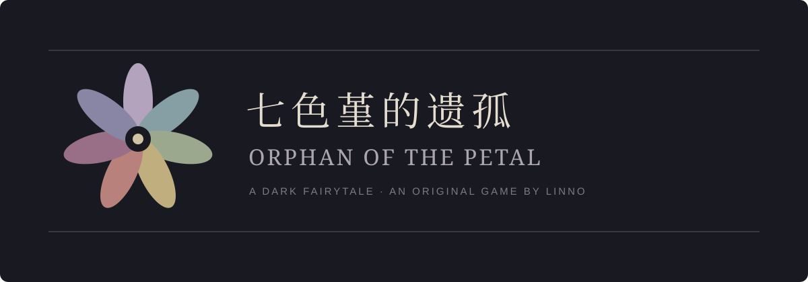

<a href="README.md">简体中文</a> · <a href="https://store.steampowered.com/app/975050/Orphan_of_the_Petal/">Play the original on Steam</a>

**A flower that grants wishes. A girl who is forgetting herself.**

Orphan of the Petal is a dark-fairytale puzzle adventure Linno made during secondary school.
After Vini makes a wish, her family and memories disappear. With Deacon and Jenny, she
explores an unfamiliar house through journals, torn pages, optional puzzles and consequential choices.

The original was released on **February 4, 2019** and is currently free on Steam.
This repository preserves the historical **RPG Maker VX Ace / RGSS3** project.
**The original supports Simplified Chinese only. This README is not an English game patch.**

## The original

- Exploration, inventory puzzles and mild horror.
- Optional puzzles and collectible story documents.
- Six endings affected by sacrifices, wishes and collected clues.

See [Steam](https://store.steampowered.com/app/975050/Orphan_of_the_Petal/) for original
screenshots, media and reviews. Historical screenshots and third-party videos are linked
instead of being repackaged before their rights have been checked.

| Action | Key |
|---|---|
| Move | Arrow keys |
| Inspect / confirm | Enter, Z, Space |
| Menu / cancel | X, Esc |
| Run | Hold Shift |
| Restart | F12 |
| Fullscreen / windowed | Alt + Enter |

The Steam installation is recommended. The archived source may differ from the store build
and requires compatible Windows. Some puzzles have unforgiving failure conditions;
the [spoiler-marked walkthrough index](docs/WALKTHROUGH.md) may help.

## New development

Two separate paid games are in development: a **bilingual 2D remake** and a **fixed-camera
3D dreamcore game**. Commercial development is private; this repository remains the
original work's archive and public information page.

Legacy inventory and initial shared gameplay logic checks are complete. Unity player builds,
actual duration, native-English editing and player testing remain unverified. No release
date is announced. See the [roadmap](docs/ROADMAP.md).

## Credits and rights

The existing [MIT notice](LICENSE) is unchanged. Third-party scripts, art, music, fonts
and runtime components retain their own terms. Presence here is not proof of commercial
reuse or raw redistribution rights. Read [the asset policy](docs/ASSET_POLICY.md).
The new SVG wordmark is original documentation art, not a screenshot of a finished remake.

Report bugs through [Issues](https://github.com/RWLinno/Orphan-of-the-Petal/issues), including
version, OS and reproduction steps. Mark story spoilers clearly.

Updated September 30, 2026. Check Steam for current store information.
