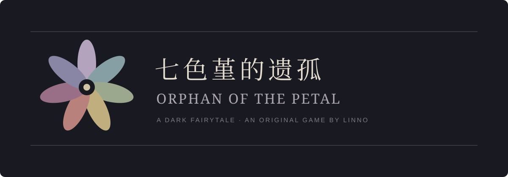

<a href="https://store.steampowered.com/app/975050/Orphan_of_the_Petal/">Steam 免费原版</a> · <a href="README.en.md">English</a> · <a href="docs/WALKTHROUGH.md">攻略与实况</a> · <a href="docs/ROADMAP.md">重制进展</a>

**一朵能实现愿望的七色花。一个正在忘记自己的人。**

《七色堇的遗孤》是 Linno 中学时期制作的 RPG Maker 黑童话解谜游戏。
薇妮许下愿望后，亲人和记忆逐渐消失。她与迪肯、珍妮一同探索陌生的宅邸，
从日记、残卷与可选谜题里，寻找七色花田下的秘密。

原版于 **2019 年 2 月 4 日**在 Steam 发布，当前免费游玩。
本仓库保存历史 **VX Ace / RGSS3** 工程；原版目前仅提供简体中文。
英文仓库说明不代表游戏已经支持英文。

## 游戏里有什么

- 以探索、道具和线索组合为主的轻度恐怖解谜。
- 部分可跳过的谜题与文献收集。
- 由献祭、愿望和收集条件共同影响的六结局。
- 薇妮、珍妮和迪肯之间逐步揭开的黑童话。

原版截图、影片和玩家评测请查看 [Steam 商店](https://store.steampowered.com/app/975050/Orphan_of_the_Petal/)。
这里链接原始页面，不重新打包未完成授权核查的旧截图、音乐或视频。

## 开始游玩

推荐通过 Steam 安装。仓库中的历史版本可能与商店构建不同；直接运行需要兼容的 Windows 环境。

| 操作 | 按键 |
|---|---|
| 移动 | 方向键 |
| 调查／确定 | Enter、Z、空格 |
| 菜单／取消 | X、Esc |
| 跑步 | 按住 Shift |
| 重启游戏 | F12 |
| 全屏／窗口 | Alt + Enter |

字体问题见历史 [readme.txt](readme.txt)。原版部分谜题可能需要重新读档；
请按需查看带剧透提示的[攻略入口](docs/WALKTHROUGH.md)。

## 重制开发

正在制作两个独立收费产品：**中英 2D 重制版**与**固定镜头的 3D 梦核新作**。
新工程采用私有开发；本仓库继续作为原作档案与公开信息入口。

原作盘点与新工程首轮状态逻辑验证已完成。Windows 构建、实际时长、英语人工校对
和玩家测试仍待验收，暂未公布发售日期。详见[路线与状态](docs/ROADMAP.md)。

## 素材、署名与许可

[原 MIT 许可](LICENSE)保持原样。第三方脚本、字体、音乐、图像及运行库保留各自条款，
不能因出现在仓库中就推定获得商用或原文件再分发许可。原片尾署名仍保存在工程中。
详见[素材与授权说明](docs/ASSET_POLICY.md)。

本页七瓣花标识是新增原创 SVG 文档图形，不是重制版实机截图。

欢迎通过 [Issues](https://github.com/RWLinno/Orphan-of-the-Petal/issues)反馈，附版本、系统、
问题位置和复现步骤。剧情讨论请标注「剧透」，不要上传访问凭据或未经许可的素材。

更新：2026-09-30。商店信息以 Steam 当前页面为准。
